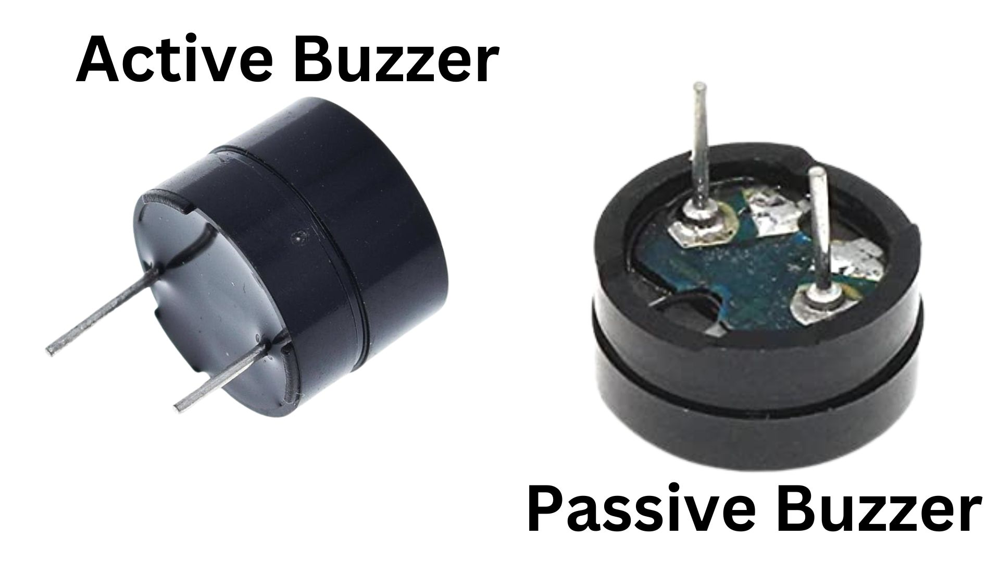
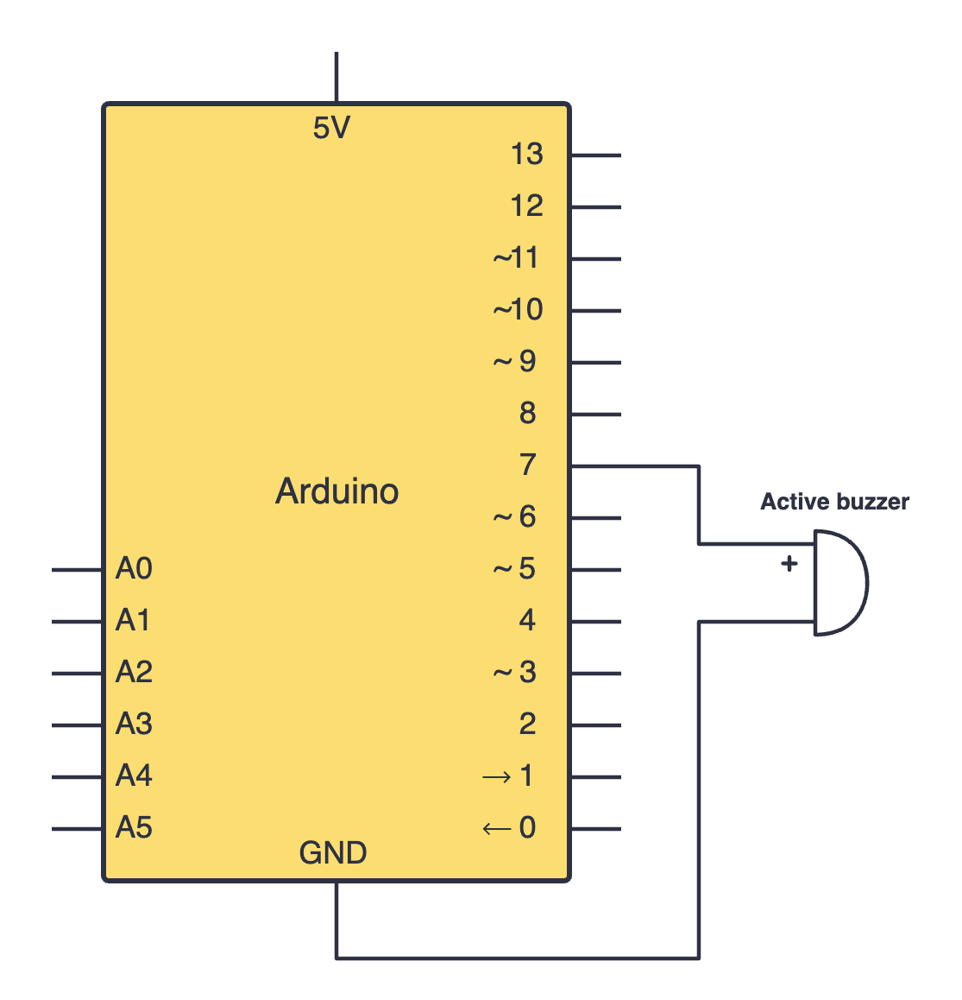
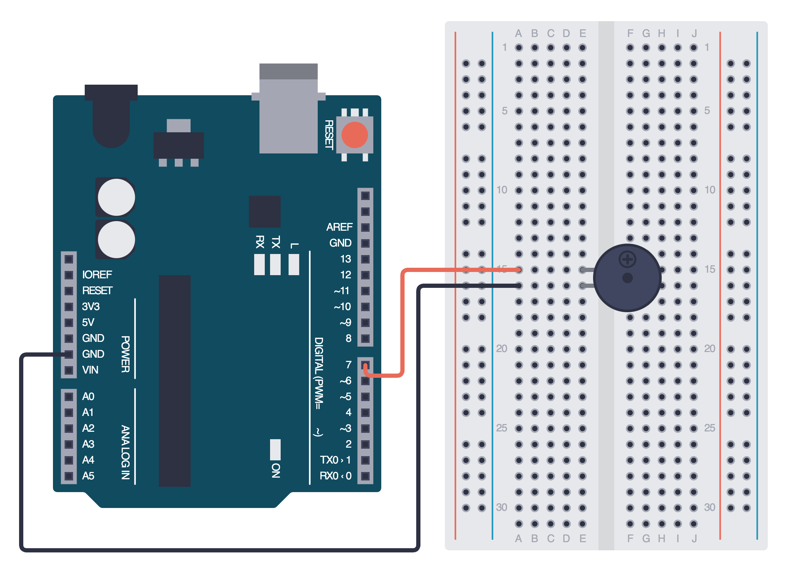
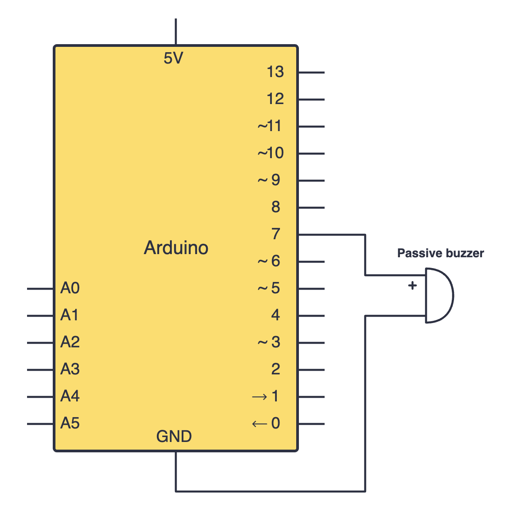

import Tabs from '@theme/Tabs';
import TabItem from '@theme/TabItem';
import LessonMeta from '@site/src/components/LessonMeta';

# Buzzers

<LessonMeta {...frontMatter} />

Buzzers are an easy and effective way to bring in sound into your Arduino projects. We must understand that there are 2 different types of buzzers: active buzzers and passive buzzers. 

<div class="img-center"></div>

## Understanding Digital vs. Analog Signals

Before diving into buzzers, it's important to understand that Arduino pins can work with two types of signals:

**Digital Signals** are simple on/off signals:
- They are either HIGH (5V) or LOW (0V)
- Arduino digital pins (D0-D13) send and receive these signals
- Used for components that only need to be ON or OFF (like LEDs or active buzzers)
- `digitalWrite()` function controls digital pins

**Analog Signals** vary continuously:
- They can be any voltage between 0V and 5V
- Arduino analog pins (A0-A5) read analog values
- Used for components that need variable control (like buzzers with variable tones, potentiometers, light sensors)
- `analogRead()` function reads analog pins
- PWM (Pulse Width Modulation) on certain pins simulates analog output

This distinction is crucial when selecting which pin to use and how to control your components. Digital pins work best for simple on/off control, while analog signals allow for more nuanced control of component behavior.

## Using active buzzers

Active buzzers have a built-in oscillator circuit that automatically generates a fixed tone when powered. They work with **digital signals** — you simply apply DC voltage (HIGH) and they produce sound.

**Key characteristics:**
- Require only DC voltage to operate
- Produce a single, fixed frequency tone (cannot be changed)
- Simple to control using `digitalWrite()` — just turn them ON or OFF
- Great for: alarms, notifications, simple beeping alerts
- Generally louder and more directional

**Why use active buzzers?**
When you need a simple alert sound that doesn't change, active buzzers are perfect. The built-in oscillator means you don't need to send any specific frequency signal — just power it and it beeps!

### Constructing your circuit

Components required:
- 1x Active buzzer
- Your Arduino board
- Breadboard
- Jumper wires

:::info[Try it yourself]
<Tabs>
  <TabItem value="problem" label="Problem">
    Search up your active buzzer's datasheet online. Datasheets will be your friend when learning about new components since they provide all the necessary information you will need to construct your circuit!

    Try building your circuit using this schematic:
    
    <div class="img-center"></div>
    <br></br>
  </TabItem>
  <TabItem value="solution" label="Solution">
    Below is the equivalent circuit diagram for this schematic. Did you hook up your components correctly?

    <div class="img-center"></div>
    <br></br>
  </TabItem>
</Tabs>
:::

### Programming your active buzzer

Active buzzers can be programmed in a similar way as LEDs using the `digitalWrite()` function with a **digital pin**.

```cpp
int buzzerPin = 7; // Active buzzer connected to pin 7

void setup() {
  pinMode(buzzerPin, OUTPUT);
}

void loop() {
  digitalWrite(buzzerPin, HIGH); // Turn buzzer ON
  delay(1000);                   // Wait 1 second
  digitalWrite(buzzerPin, LOW);  // Turn buzzer OFF
  delay(1000);                   // Wait 1 second
}
```

- `digitalWrite(buzzerPin, HIGH)` sends 5V to our buzzer, making it play a tone. This tone **cannot** be changed.

## Using passive buzzers

Passive buzzers do not have a built-in oscillator. They require an **analog signal** (or PWM) at a specific frequency to vibrate and produce sound. This makes them more versatile but slightly more complex to control.

**Key characteristics:**
- Require AC signal or PWM (varying signal) to produce sound
- Can produce different tones by varying the frequency
- Controlled using the `tone()` function with frequency parameters
- Great for: musical melodies, varied alert sounds, multi-tone applications
- More flexible but requires more programming
- Can play musical notes at different frequencies

**Why use passive buzzers?**
When you need flexibility in sound — like playing melodies, different alert tones, or musical notes — passive buzzers are the choice. You control exactly what frequency is played, giving you complete control over the sound produced.

### Constructing your circuit

Components required:
- 1x Passive buzzer
- Your Arduino board
- Breadboard
- Jumper wires

:::info[Try it yourself]
<Tabs>
  <TabItem value="problem" label="Problem">
    This time, search up your passive buzzer's datasheet online. Passive buzzers are connected in the same way as our active buzzers. Try building your circuit once more using this schematic:
    
    <div class="img-center"></div>
    <br></br>
  </TabItem>
  <TabItem value="solution" label="Solution">
    Below is the equivalent circuit diagram for this schematic. Did you hook up your components correctly?

    <div class="img-center"></div>
    <br></br>
  </TabItem>
</Tabs>
:::

### Programming your passive buzzer

To program a passive buzzer to make it play tones, we have to use the [`tone()`](https://docs.arduino.cc/language-reference/en/functions/advanced-io/tone/) function. The `tone()` function generates a square wave of a specified frequency on a digital pin. This varying signal (analog-like) makes the passive buzzer vibrate at that frequency, producing the corresponding tone.

We can use the `noTone()` function alongside this to turn off the `tone()` function. Let's look at this example sketch to understand how this works better:

```cpp
int buzzerPin = 7; // Passive buzzer connected to pin 7

void setup() {
  // No pinMode needed for tone() function
}

void loop() {
  tone(buzzerPin, 1000); // Play 1000Hz tone
  delay(1000);
  noTone(buzzerPin);     // Stop tone
  delay(1000);
}
```

## Assignment 

:::info Your Turn
1. The `tone()` function can be used to play melodies by generating musical notes at a specific frequency. Try playing around with different frequencies to create a simple, short melody that consists of at least 3 notes. (Hint: Middle C on a piano is around 262Hz)
:::

## Next Steps

This section includes links to help you dive deeper into the topics from this lesson. It's optional, so don't worry if you choose to skip it.

- [This article](https://www.engineersgarage.com/how-to-play-musical-notes-on-arduino/) covers how to use buzzers to play more complicated songs.
